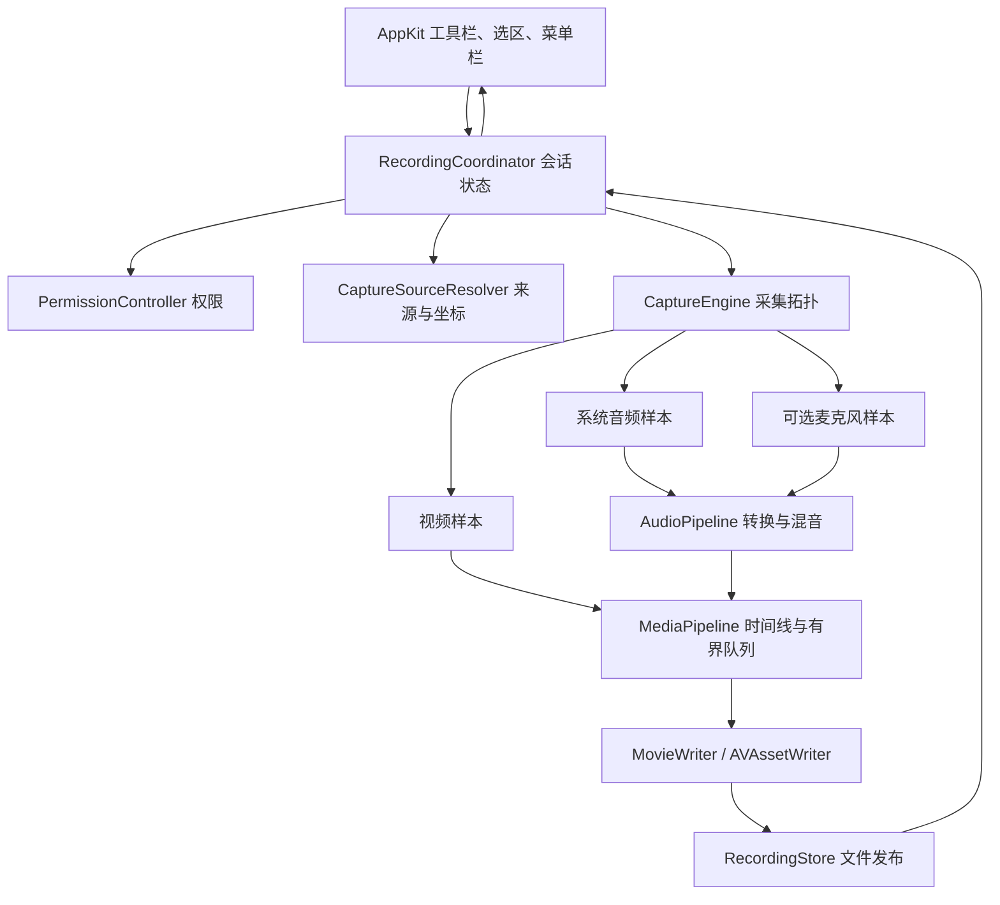
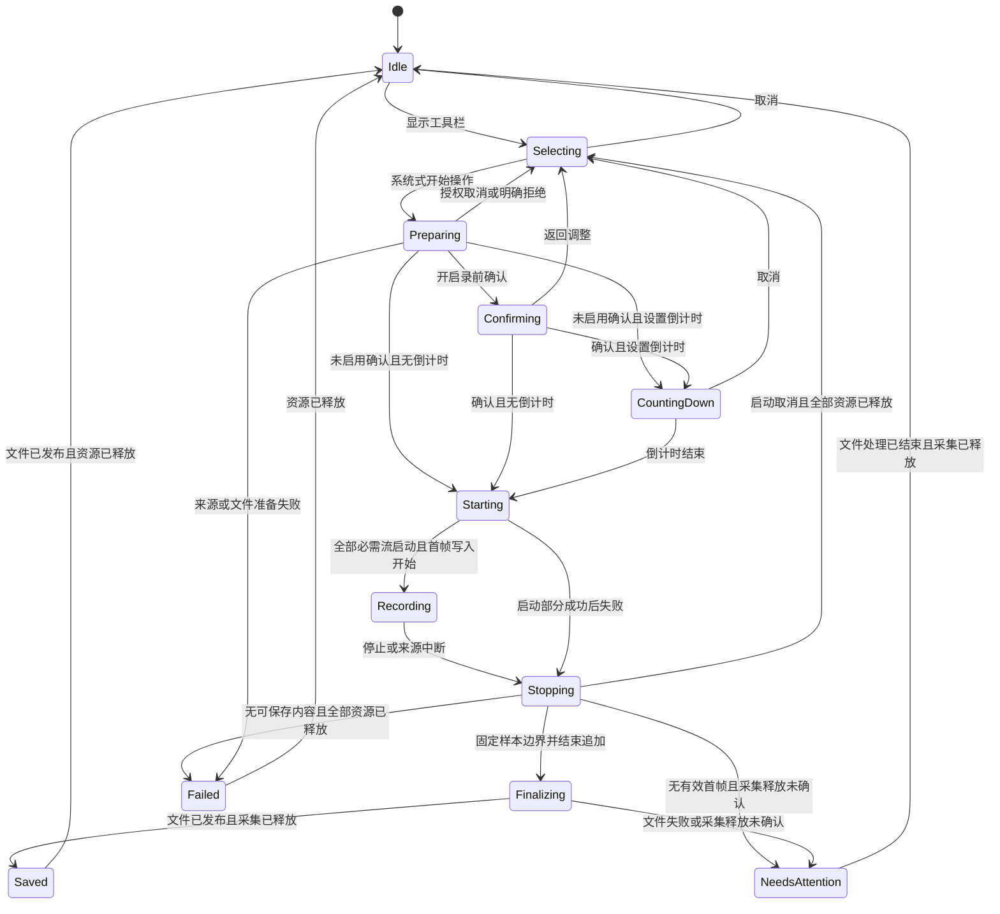

# Screen Recorder 架构设计

## 编写动机与实际痛点

这个项目源于 macOS 26.6.2 上的实际录屏体验：系统 `⌘⇧5` 的工具栏、框选和停止操作已经足够轻便，希望沿用这套熟悉的交互，同时让电脑正在播放的声音可靠地进入视频。

核心诉求是：**复刻系统 `⌘⇧5` 的录屏操作与默认行为，增加录制系统声音；保留可选的自定义画质、帧率、保存目录和录制前确认，未经用户调整时不改变系统式体验。** 戴着 AirPods 也能录到系统播放的声音，结束后继续正常使用耳机。

本文以用户当前的 macOS 26.6.2 系统录屏为对照。自定义能力必须保留，但默认不启用额外步骤、不强制降低分辨率、不指定固定帧率、不改用专用保存目录。“与系统一致”指对齐同一系统和设备上的默认行为，不表示读取或修改系统“截屏”应用的私有偏好设置。

| 痛点 | 实际体验或使用诉求 | 对本软件的要求 |
| --- | --- | --- |
| 录到了画面，却没有预期的系统原声 | 使用系统录屏并选择 AirPods Max 通道后，成品没有录入预期的电脑播放声音。 | 系统声音作为独立、明确的录制来源，默认开启，并核对音轨的实际内容。 |
| 耳机通道容易与系统声音混淆 | 录屏选项中的 AirPods Max 对应耳机麦克风，用户容易以为选择它就会录下耳机里听到的声音。 | 分别展示“系统声音”和“麦克风”，明确设备选择属于哪个来源；录系统声音不要求开启耳机麦克风。 |
| 停止提示与实际会话状态不清楚 | 曾出现菜单栏显示 `SystemUIServer` 正在共享，点击“停止共享”没有反应，难以判断采集是否真正结束。 | 分开管理文件保存和采集释放状态，停止超时给出明确结果，不能仅因视频文件生成就报告全部结束。 |
| 耳机的日常使用可能受到音频状态异常影响 | 在录屏状态问题的处理过程中，曾遇到 AirPods Max 无法从 Mac 自动切换到 iPhone；断开并重新连接 Mac 后恢复。 | 不改变默认音频设备、配对或自动切换设置；按需开启麦克风，结束后释放本应用的音频会话，不主动抢回耳机。 |
| 为补齐声音功能增加配置负担 | 需求是轻量录屏，希望打开工具、选择范围、开始、停止即可完成，不希望为录系统声音额外配置虚拟声卡或多输出设备。 | 使用 macOS 原生采集能力，提供可直接运行的本地应用，保持选项精简。 |
| 换工具会打断已有操作习惯 | 已经习惯系统录屏的底部悬浮工具栏、屏幕与区域选择，以及菜单栏停止入口。 | 按目标系统对齐布局、操作、默认值和录后行为，将系统声音作为自然补充，不引入复杂工作台。 |

耳机自动切换异常与此前录屏服务处理之间的因果关系尚未确定。这里记录的是实际遇到的现象与需要防范的副作用，不能据此认定某个系统服务就是故障原因。

因此，“录制成功”需要同时满足三个条件：画面和所选声音实际进入可播放文件、文件已完成保存、本应用的采集与音频会话已结束。正常录屏不应要求用户事后重启系统服务或重新整理耳机连接。

## 项目定位

项目目录为 `screen-recorder`，应用显示名称为 **Screen Recorder**。本文定义拟实现的架构、交互和行为约束，不表示所列功能已经实现。

目标是一个本机运行的 macOS 轻量录屏工具：复刻系统 `⌘⇧5` 的录屏部分，包括悬浮工具栏、来源选择、选项、停止和录后缩略图操作，直接录制屏幕和系统播放的声音，按需叠加麦克风旁白。不扩展截图工作台。

默认使用流程是：打开工具栏 → 选择全屏、窗口或区域 → 开始录制 → 从菜单栏或快捷键停止 → 获得可播放的视频文件。调整声音和其他选项均为可选；只有用户开启“录制前确认”后才增加确认步骤。

设计约定：

- 以 macOS 26.6.2 为当前交付与界面对照基线，优先适配 Apple Silicon；本次不为旧系统引入另一套交互、虚拟声卡或兼容守护进程。
- 使用 Swift、AppKit、ScreenCaptureKit、AVFoundation 与 CoreMedia，应用运行不依赖第三方框架、网络服务或外部编码器。
- 系统声音默认开启，麦克风默认关闭；声音开关与画面来源分别选择。
- 输出与系统录屏一致的 `.mov` 文件。SDR 使用 H.264，支持的设备可按系统选项使用 HEVC HDR；存在声音时使用 AAC，启用两种声音时混成一条可直接听到全部内容的音轨。
- 默认保存到用户“桌面”，保留其他位置选择；用户主动选择后记住该位置，不自行改动桌面的 iCloud 同步设置。
- 所有录制由用户主动开始；启动应用、显示工具栏和闲置状态不启动采集。
- 单次录制对应一个固定画面来源和一个输出文件。

当前功能范围不包含摄像头画中画、直播、完整视频编辑工作台、云同步、后台回溯录制、跨显示器拼接和独立的暂停续录功能。系统录后缩略图已有的查看、基础修剪、分享、拖动和删除操作属于对齐范围，不能因“不做编辑器”而删除。受系统保护而无法采集的内容不作绕过处理。

Apple 的[录屏说明](https://support.apple.com/zh-cn/102618)列出了桌面保存、MOV、窗口录制、停止快捷键及支持设备上的 SDR/HDR 选项；这些行为须在目标机器逐项对照。该说明还列出 macOS 27 起的系统音频选项，因此不能将“系统录屏始终不能录系统声音”写成跨版本结论。

## 交互设计

### 应用入口与快捷键

应用以菜单栏工具运行，双击应用或点击空闲时的菜单栏图标显示悬浮工具栏。工具栏可拖动，首次出现在鼠标所在显示器的底部中央，拖动后保存位置，关闭工具栏或退出应用后再次打开仍恢复该位置。恢复时按当前显示器布局与可见范围校正越界坐标，不能仅因窗口与屏幕有交集就把初始原点当成有效记忆位置。

目标调用快捷键为 `⌘⇧5`，停止快捷键为系统录屏使用的 `⌃⌘Esc`，不能用同一个快捷键兼任停止。`⌘⇧5` 通常已被系统占用：只有用户主动在系统设置解除原绑定后，本应用才能注册；冲突时说明原因，双击应用与菜单栏入口仍可使用。不得自动覆盖系统绑定，也不申请辅助功能或输入监视权限。应用退出后不承诺全局快捷键仍能唤起应用，不安装常驻辅助进程。

录制时菜单栏按系统样式显示停止入口；点击只提交一次停止请求，默认不增加红色计时条或额外悬浮状态面板。退出应用时，进行中的录制先停止并完成保存，再退出。

停止热键也必须检查注册结果；冲突时保留菜单栏停止入口并明确提示，不申请额外输入权限抢占绑定。用户在录制期间主动再次调用应用时，可以显示停止控制；录制本身不自动增加悬浮面板。

### 悬浮工具栏

工具栏采用系统风格的圆角、半透明背景、分组图标与清楚的选中态，结构为：

`关闭 | 录制整个屏幕 | 录制窗口 | 录制所选区域 | 选项 ▾ | 录制`

| 控件 | 行为 |
| --- | --- |
| 关闭 | 关闭本次选择界面，保持应用空闲，不退出其他应用。 |
| 整个屏幕 | 按系统方式选择显示器并开始；一个文件只录一块显示器。 |
| 窗口 | 鼠标经过时高亮可录制窗口，点击目标窗口即提交开始请求；默认不要求点选后再按一次“录制”。 |
| 所选区域 | 拖动建立矩形，支持移动选区与八个边缘调整点，显示宽高；选区限制在同一显示器内。 |
| 选项 | 保留系统录屏选项，增加系统声音，以及默认不改变系统行为的自定义画质、帧率和录前确认。 |
| 录制 | 来源有效且准备条件满足后进入倒计时或启动录制。 |

没有选定窗口、选区为空或来源已经失效时，“录制”不可用，并给出对应原因。不能按旧的窗口标题猜测新的录制对象。

选区支持 `Esc` 取消。选区和高亮层只服务当前选择过程，不遮挡系统授权对话框，也不改变其他应用的辅助功能设置。

窗口模式保留悬停高亮和点击即开始，也可从“选项 → 选择录制窗口”的原生菜单使用方向键和回车选择，供键盘与 VoiceOver 使用。列表只用于当前选择过程，不跨桌面切换或应用重启复用；实际开始前仍复验窗口与应用身份。

### 选项菜单

| 选项 | 默认值与边界 |
| --- | --- |
| 系统声音 | 默认“全部系统声音（所有桌面）”；可选“仅所选应用（所有桌面）”或关闭，三个画面模式保持相同含义。 |
| 麦克风 | 默认“无”；使用系统式的“无 / 具体设备”列表，选择设备即启用，不增加一套必经的设备配置页。 |
| 保存到 | 默认“桌面”；保留系统可用的目的地与“其他位置”，记住用户主动选择的目录。 |
| 倒计时 | 无、5 秒、10 秒，默认无；倒计时可以取消。 |
| 画质 | 默认“自动（系统默认）”；保留“标准”和“清晰”供主动选择，默认不套用 1080p 或 4K 上限。 |
| 帧率 | 默认“自动（系统默认）”；保留 30 fps、60 fps，作为用户选择后的采集帧率上限。 |
| 录制前确认 | 默认关闭；开启后在实际录制或倒计时开始前展示简洁确认，可开始或返回调整。 |
| 格式 | 与目标系统在本机的初始选择和可用项一致；支持时提供 SDR / HDR，不假定所有设备都支持 HDR。 |
| 显示浮动缩略图、记住上次所选内容、显示鼠标点按 | 保留目标系统录屏的同名选项与初始勾选状态；不把仅截图模式存在的选项带入录屏。 |

系统录屏没有独立的“画质档位”和“帧率数值”菜单。“自动”表示实现需要依据同机系统录制结果，对齐画面尺寸、清晰度、色彩和动态画面流畅度，不是声称存在可直接调用的“系统默认参数”API。不得把自定义的 1080p、30 fps 或固定码率伪装成系统默认值。具体编码参数在实现时依据对照结果确定，保持内部配置，不增加必填操作。

自动策略的对照记录必须注明机器、系统、显示器缩放、来源范围与格式；原生工具和本应用分别录制同一静态、滚动及视频播放场景。输出尺寸与来源边界应一致；编码、位深、色域和传递函数逐项核对；动态场景记录帧时间分布、丢帧与重复帧，而非仅比较平均帧率。清晰度检查使用同尺寸文字和细线，不允许通过缩小画面掩盖差异。对照完成前，界面仅称“自动”，不得标注已经达到系统默认画质；无法定量判定的项目保留明确的未验收状态，不以编译成功替代。

用户主动选择“标准”时，以 1920×1080 为输出边界；主动选择“清晰”时，以 3840×2160 为输出边界。均保持来源比例，不放大低分辨率来源；竖屏按长短边对应限额处理，编码尺寸只向选区内对齐，不带入相邻像素。“自动”不使用这两个缩放上限。SDR/HDR 的采集动态范围、缓冲格式、色彩转换和文件色彩元数据必须一致，不将 SDR 内容仅标记成 HDR。

“显示鼠标点按”使用系统公开采集能力，不引入全局鼠标监听。ScreenCaptureKit 的该能力受像素格式限制，不能假定任意 HDR 或 YUV 管线都可直接启用；应对照本机系统提供的组合实现，不能静默忽略已选项。参见 [showMouseClicks](https://developer.apple.com/documentation/screencapturekit/scstreamconfiguration/showmouseclicks)。

使用耳机麦克风可能切换耳机的音频工作模式。用户主动选择蓝牙耳机麦克风时，设备说明应提示可能影响耳机音质与跨设备使用；不能为了录制系统声音自动开启它。Apple 对蓝牙麦克风工作模式与音质变化的说明见[官方支持文档](https://support.apple.com/zh-cn/102217)。

### 开始、录制与结束

开始前由应用自动复验来源、声音设备、输出规格与保存权限，不增加默认确认页。用户开启“录制前确认”时，才展示来源、画质与帧率设置、声音、麦克风和保存位置的简洁摘要；确认后进入倒计时或直接启动，返回则继续调整。进入倒计时后设置冻结，修改设置需要先取消倒计时；`Esc` 可以取消选择或倒计时。

启动采集前隐藏工具栏和选择层，同时在采集过滤器中排除本应用的工具窗口。所有必需采集流启动成功，且收到可写的完整视频帧并成功开始写入后，才进入“正在录制”状态；不额外显示自定义计时面板。

录制期间只显示轻量的菜单栏状态与可选选区边框。边框不接收鼠标事件，并从视频中排除。系统自身的录屏隐私指示保持正常工作。

停止不弹确认。正常收尾后，按“显示浮动缩略图”设置展示系统式缩略图；关闭该选项时直接保存，不增加文件大小、路径摘要或成功弹窗。保存耗时明显时才显示必要进度，不遮挡正常操作。异常必须说明实际保存与释放状态。

缩略图的停留、关闭、拖动、点击预览，以及基础修剪、分享、删除和完成行为均对照目标系统。分享或拖动只能提供已完成封装的文件；修剪先写入独立临时文件，成功后再替换本应用产物，失败时保留原文件。不以“交给外部播放器打开”替代系统录后操作，也不扩展素材库或时间线编辑工作台。

每个完成文件分配独立成品标识，与正在录制的会话分开管理。对同一成品的修剪提交、替换、移动和删除必须串行；修剪提交前复验文件身份，已删除或已被外部替换的文件不得由迟到回调重新生成或覆盖。分享与拖动期间保留有效文件访问，冲突的破坏性操作延后或明确拒绝。新录制不使旧成品回调失效，也不能使旧成品操作作用于新文件。退出时须等待或取消修剪并确认临时文件不再使用，再清理本次产生的临时文件；未提交修剪失败时保留原件。

用户在录制中退出应用时，先停止并保存后退出；需要用户处理的保存失败必须说明。不能先退出进程再尝试补写视频文件。

## 技术结构

| 模块 | 职责 | 关键边界 |
| --- | --- | --- |
| `AppController` | 应用生命周期、菜单栏、热键、正常退出。 | 不直接接收或写入媒体样本。 |
| `ToolbarController` | 模式选择、选项、来源确认和录制入口。 | 只展示会话状态，不能自行宣布保存成功。 |
| `SelectionController` | 显示器、窗口与矩形选择，高亮和调整。 | 不取得辅助功能权限，不自动切换其他应用的窗口。 |
| `RecordingCoordinator` | 串行管理准备、开始、停止、保存和失败。 | 一个时刻最多存在一个采集会话。 |
| `PermissionController` | 核对屏幕与可选麦克风权限。 | 不自动扩大权限，不修改系统权限数据库。 |
| `CaptureSourceResolver` | 将用户选择解析为当前有效的来源、过滤器与几何规格。 | 不把失效窗口替换成同名窗口或整个桌面。 |
| `CaptureEngine` | 建立与停止 `SCStream`，转发视频和音频样本。 | 管理本应用的流，不重启系统服务。 |
| `AudioPipeline` | 统一音频格式、对齐、填充静音和混音。 | 不设置系统默认设备或系统音量。 |
| `MediaPipeline` | 时间戳、样本有效性、背压与停止边界。 | 队列有上限；不积累完整录制内容。 |
| `MovieWriter` | 单一 `AVAssetWriter` 写入路径与封装完成。 | 同一会话的所有写入与结束操作严格串行。 |
| `RecordingStore` | 保存目录、临时文件、正式发布和失败产物管理。 | 不覆盖已有文件，不把未封装完成的文件当作成品。 |
| `ArtifactController` | 完成文件的预览、修剪、分享、拖动和删除。 | 按成品标识管理操作与文件身份，不复用采集会话状态。 |

以上是单个应用内的职责划分，不拆成独立包、服务或插件。实现按 `App`、`UI`、`Capture`、`Media`、`Storage` 组织即可，不为每项职责建立框架。

界面状态由主线程管理。控制操作串行化，媒体回调与写入使用专用串行队列，文件检查与目录访问不阻塞界面。媒体缓冲的持有和释放有明确队列归属，不在多个执行域之间共享可变缓冲。

每次录制分配独立的会话标识。异步授权结果、来源查询、采集回调和保存回调都携带该标识；旧会话的迟到回调不能改变新会话的状态或写入其文件。

## 画面来源与系统声音

### 音频含义必须稳定

“系统声音”默认指 Mac 整体应用音频，包含所有桌面，不因用户从全屏切换到窗口录制而变成“只录这个窗口所属应用”。用户可以主动改为仅采集明确选择的应用，或关闭；更改画面模式不能改变已选择的声音范围。系统提示音等是否可采集，以 macOS 对采集流的实际提供范围为准。

应用过滤不是 Space 过滤，同一应用在其他桌面或其他窗口发出的声音仍可能进入录制。所选应用列表可以多选，空列表不能开始，应用缺席不能静默扩大为全系统声音。启动时冻结所选应用进程，退出或重启后停止并保存，由用户重新选择开始；不把新进程当作旧来源继续采集。

选项的简短说明必须明确：即使只录一个窗口，也可能录到其他应用的声音。不能承诺受保护媒体、通话或所有系统提示音都可采集；不提供逐应用混音台。

ScreenCaptureKit 的音频过滤以应用为单位：单窗口过滤器会带上该窗口所属应用的音频，不能直接代表全系统声音。这是采集拓扑需要处理的实际限制，见 Apple 的 [ScreenCaptureKit 说明](https://developer.apple.com/videos/play/wwdc2022/10155/)。

| 录制模式 | 视频来源 | 默认“全部系统声音”时的音频来源 |
| --- | --- | --- |
| 整个屏幕 | 指定显示器，排除本应用工具窗口。 | 同一显示器采集流的系统音频，应用音频过滤不收窄到某个窗口。 |
| 所选区域 | 指定显示器内的 `sourceRect`。 | 与全屏相同；裁剪画面不收窄音频范围。 |
| 指定窗口 | 锁定的独立窗口过滤器。 | 单独的系统音频采集流，覆盖整体应用音频。 |

默认全部系统声音时，全屏和区域模式复用同一 `SCStream` 的视频、系统音频输出。窗口模式的视频流关闭其系统音频输出，另建只消费音频输出的采集流，避免同一声音重复进入文件。选择仅所选应用声音时，三个画面模式均关闭视频流的系统音频，使用按所选应用过滤的独立音频流；画面过滤范围保持用户原选择，不随音频范围收窄。

独立音频流不订阅画面样本，使用低刷新、极小画面规格控制额外资源消耗；不能把第二份桌面画面缓存到内存或写入文件。声音关闭时不创建这条流。

不订阅视频并不意味着采集服务完全没有画面处理成本，需核对实际消耗。一个会话最多两条流，不为每块显示器重复采集系统声音；默认全部系统声音时，录制后启动的新应用也应进入范围，不能使用冻结的应用白名单遗漏声音。主动选择应用过滤时只接受冻结的所选进程。承载音频流的显示器失效时，必须进入统一中断处理，不能无声继续。

系统声音显式设置 `capturesAudio` 与 `excludesCurrentProcessAudio`，排除本应用自身音频，统一请求 48 kHz、双声道，不能依赖框架默认值。API 行为见 [capturesAudio](https://developer.apple.com/documentation/screencapturekit/scstreamconfiguration/capturesaudio)。

系统声音直接进入文件管线，不经过扬声器外放再由麦克风拾取。采集到的音频不在本应用中再次回放，避免回声和重复播放；用户原本的耳机或扬声器收听路径交给系统维持。

### 麦克风

麦克风是单独的可选来源。使用 ScreenCaptureKit 的麦克风输出及明确的 `microphoneCaptureDeviceID`；这些能力由 macOS 15 提供，见 [Apple 的麦克风采集说明](https://developer.apple.com/videos/play/wwdc2024/10088/)。

默认关闭时不申请麦克风权限、不打开麦克风采集会话。开启后仅使用用户明确选中的设备；找不到设备时要求重新选择，不能自动改用 AirPods、iPhone 连续互通麦克风或其他设备。

麦克风输出只挂接到画面采集流。窗口模式的独立系统音频流始终关闭麦克风采集，防止同一个麦克风被打开两次或重复混入成品。

麦克风样本使用所选设备的原生格式，不能因系统声音请求了 48 kHz 双声道，就假定麦克风格式也相同。必须读取每个来源的实际格式并转换；单声道旁白应正确映射到成品的左右声道，不能只在一侧可听。

麦克风设备在录制期间断开时，停止并保存已取得的内容，提示具体中断原因。不能悄悄替换设备继续录音。

### 画面身份与坐标

- 显示器来源绑定当前显示器身份与逻辑边界；启动前复验显示器仍存在。
- 窗口来源绑定窗口标识、所属进程和应用身份；窗口关闭或所属应用退出时结束录制。
- 窗口被其他窗口遮挡时仍锁定原窗口，不切换到遮挡它的应用。
- 区域保存在所属显示器的局部逻辑坐标中，不直接把屏幕全局像素当作裁剪参数。
- Cocoa 屏幕坐标、采集逻辑坐标与输出像素分开转换；使用来源的实际像素缩放比例，不固定假设 Retina 等于两倍。
- 录制开始时冻结输出画布尺寸。来源窗口调整大小后等比例适配画布，必要时补边，不在文件写入中途改变视频轨道规格。
- 多显示器排列、缩放或来源可用性变化后重新核对，不用过期坐标扩大录制范围。

来源不可采集或持续无法提供有效画面时应给出明确状态；不能以黑帧、其他窗口或整个桌面冒充目标来源。

独立窗口采集不保证包含该窗口的独立弹窗或子窗口，不能扩大到整个桌面补齐。最小化、恢复、切换 Space 和窗口跨屏后的界面与录制表现，须与目标系统逐项对照；采集层必须区分窗口暂停更新与来源已关闭，不能只凭没有新画面就认定窗口消失。暂停时不得换录其他窗口，恢复时仍须复验原窗口身份。

### 多桌面（Space）边界

Space 与物理显示器是不同的来源概念。全屏和区域模式绑定显示器，会采集该显示器当前显示的桌面；不提供把已切走的完整 Space 持续作为后台画面来源的承诺，也不能用冻结窗口集合或逐窗口拼接冒充完整桌面。

需要切换桌面后继续录制原内容时，使用独立窗口模式，始终绑定原窗口和应用身份，不随当前桌面或前台应用切换。窗口被遮挡或不在当前 Space 时不能仅凭“当前不可见”判断来源消失；关闭、最小化及应用不再渲染需分别处理。依据 Apple 的[独立窗口采集说明](https://developer.apple.com/videos/play/wwdc2022/10155/)，窗口来源独立于显示器和 Space；仍需在目标系统验证持续更新和结束释放。

工具栏只在主动调用时移到当前 Space，不常驻覆盖所有桌面。选择遮罩属于创建它的当前 Space，切换桌面取消尚未完成的选择和来源查询，但不终止已启动的独立窗口录制，不激活或移动被录窗口。

## 音画时间线与文件写入

### 单一写入实现

三个画面模式统一使用 `AVAssetWriter`。选择显式媒体管线的原因是需要合并窗口视频与独立系统音频，并把系统声音、麦克风混成普通播放器直接播放的一条音轨。

ScreenCaptureKit 从 macOS 15 起已有可直接写文件的 `SCRecordingOutput`，不能声称框架没有录文件能力。本方案使用自管写入，是为了将窗口模式的跨流声音合并到同一文件，并保持三个模式的停止与混音语义一致。另需注意，`mixesAudioWithMicrophone` 从 macOS 27 起才可用，不能用于当前 macOS 26 基线。参见 [Apple 的录文件说明](https://developer.apple.com/videos/play/wwdc2024/10088/)和 [mixesAudioWithMicrophone](https://developer.apple.com/documentation/screencapturekit/screcordingoutputconfiguration/mixesaudiowithmicrophone)。

同一 MOV 文件包含一条与 SDR/HDR 选择匹配的视频轨道，最多一条 AAC 音轨。两种声音都关闭时不创建音轨；只有系统声音或只有麦克风时仍使用同一音频处理路径。不在停止后转码整段视频，不建立中间无压缩录制文件。

音频输入先转换为 48 kHz 双声道浮点 PCM，以短时间块对齐后混音，并进行限幅。不能把两个声源直接整数相加而产生溢出，也不能在播放时才依赖用户选择不同音轨。

仅按需启用格式转换，不增加默认降噪、自动增益、声音美化或混音设置。外放声音被用户开启的麦克风再次拾取时可能形成叠音，不能把系统采集无回放误写为全场景自动消回声。

### 开始基准

1. 准备写入器、固定视频与音频规格，建立会话标识。
2. 启动所需采集流，最多短暂缓存启动期间先到达的音频。
3. 所有必需采集流启动成功，且收到第一帧完整、有效、可写的视频后，确定统一起点。
4. 将各来源映射到统一的宿主时钟时间线；起点之前的样本裁去，跨越起点的音频按采样帧裁剪。
5. 成功开始文件写入后，进入“正在录制”。

不能对视频、系统声音和麦克风分别从各自的第一个回调计时。不同采集流必须保留真实时间关系；存在不同时钟域时先做时钟转换，不能简单拼接各自的相对时间。

系统授权等待不计入采集启动期限。从提交启动请求起，5 秒内未完成所有必需流启动及可写首帧准备，或任何必需流启动失败时，整次启动进入停止收尾；不能因某条流一直不返回而绕过期限，也不能无限等待并在用户离开后突然开始录制。

### 持续录制

- 视频只接收有效完整帧，时间戳严格单调；重复、倒退或旧会话样本不进入文件。
- 静止画面可以低频产出视频样本；保留最后一帧，停止时补齐尾部时长，防止长时间静态录制只生成很短的视频轨道。
- 读取 `SCFrameStatus` 区分完整帧、静止、暂停和停止。`idle` 表示内容未变化，不能用“几秒没有完整新帧”判断采集失效；末帧补时仍受写入背压、单调时间戳和停止边界约束。参见 [SCFrameStatus](https://developer.apple.com/documentation/screencapturekit/scframestatus)。
- 音频按时间轴放置；正常静音区间补零，混音时保留声源之间的时间偏移。
- 正常静音与采集流故障分别处理。音频电平为零不能直接判定故障，采集流中断也不能冒充静音继续录制。
- 蓝牙输出切换、系统音量调整等由系统处理；不通过改变默认输入输出设备维持采集。
- 音频实际格式变化时更新转换器，输出轨道保持固定规格；无法维持有效时间线时结束录制并说明原因。

混音等待任一声源必须有上限，初始以 200 ms 为等待预算；正常静音或暂时没有样本时按公共时间轴补零，不能拖住另一声源或无限增长缓存。迟到样本裁去已经写出的区间，不回写或重复混入；持续超出预算并损害所选音源完整性时停止并说明原因。真实采集错误、设备丢失和停止事件优先于静音补齐，不能被隐藏。重采样器的延迟与停止时剩余样本也计入同一预算。

### 背压和内存

采集队列与待写队列都必须有固定上限。视频优先保留较新的有效帧，允许丢弃过期视频帧以降低延迟；音频持续积压超过上限时结束录制，不能无提示丢失大段声音。

建议初始约束为采集视频队列深度 3、应用待写视频不超过 2 帧、启动音频缓存不超过 500 ms、待写音频不超过 2 秒。具体数值需在实现时按实际分辨率验证，但不得改为随录制时长增长的队列。

保留的最后一帧与正常待写队列分别计入内存预算。空闲时不保持视频缓冲池、音频转换器或采集流。

预算同时计入采集框架、编码器、转换器和窗口模式第二条流的持有量，不能只计算应用数组长度。写入器持续不接收样本时停止并报告，不能以永久丢帧掩盖停滞。

### 正常停止顺序

1. 串行接受一次停止请求，记录停止时间，拒绝重复停止和新的开始请求。
2. 请求本会话全部采集流停止，禁止继续扩大媒体时间边界。
3. 在媒体队列上完成停止时刻之前的样本，裁剪越界音频并补齐静态画面的尾帧。
4. 确认不存在并发追加后，结束音视频输入并调用写入器的完成接口。
5. 等待完成回调并检查写入器状态、输出文件和轨道信息。
6. 文件成功封装后，以不覆盖已有文件的方式发布；采集资源在停止确认后释放，不能因文件失败而跳过流的收尾。
7. 汇总文件结果与采集释放结果；正常成功后显示系统式缩略图，任一环节异常时明确报告实际状态。

写入完成是异步操作，调用完成接口本身不能代表成功。Apple 明确要求在追加样本结束后完成写入，并根据写入器状态判断结果，见 [finishWriting](https://developer.apple.com/documentation/avfoundation/avassetwriter/finishwriting(completionhandler:))。

## 会话状态与异常收尾

`RecordingCoordinator` 是状态变更的唯一入口。界面按钮、快捷键、系统停止回调、锁屏和应用退出都提交事件，不各自执行一套停止逻辑。

这些是内部状态，不对应一组必须点击的界面页面。录前确认关闭时直接跳过 `Confirming`；缩略图展示不阻止新的录制，缩略图与预览使用已经完成的文件。准备和确认阶段不提前开启媒体采集。

采集停止超时与文件写入失败必须区分：

- 采集停止超时时，先关闭本应用接收样本的入口，再尽力封装已有内容。
- 文件已经保存但系统采集会话尚未确认释放时，显示“文件已保存，采集会话尚未释放”，保持异常状态，禁止新录制。
- 采集停止与文件写入分别只完成一次。迟到的停止回执只更新释放状态；文件已经封装时不再次调用完成接口。文件处理已结束且采集已释放后才能解除录制阻塞，文件失败结果仍须保留，不能改成保存成功。
- 此时允许用户在文件处理结束后正常退出本应用；不以“保存成功”掩盖采集状态仍未解除。
- 不重启或强制结束 `SystemUIServer`、`replayd`、`coreaudiod`、蓝牙服务或其他系统进程处理异常。
- 写入器超时或失败时保留可定位的中间产物并显示原因，不发布成正常视频。
- 没有获得完整首帧的启动失败不显示录制成功；本会话创建的空文件可清理，用户已有文件不能删除。

内部必须分别记录文件结果与资源释放结果，不能用一个成功或失败值覆盖另一项。文件失败且采集释放超时可以同时发生；迟到的停止回执只能解除采集占用，不能把失败文件改成“保存成功”。文件封装成功但正式发布失败时，可让用户为完整文件另选目录；封装失败的文件不能冒充可正常另存的成品。

停止与保存使用统一的总期限，正常目标为 5 秒，超过 10 秒必须报告具体状态，不能让每个环节各自重新计时而无限延长。写入仍在运行时不得移动、删除对应文件或开始冲突的新会话；迟到回调仍按会话标识完成一次收尾。超时提示不意味着底层异步操作已被成功取消。

启动中由用户取消且尚未写入有效帧时，释放已创建的资源后返回选择界面，不生成完成缩略图。只要已有有效媒体写入，即使录制很短，也应完成正常封装后再返回。

锁屏、主动睡眠、用户切换、来源显示器断开、用户撤销采集权限以及系统停止共享均进入统一停止入口，恢复后不自动开启新录制。系统没有给出足够收尾时间的突然断电、强制结束或进程崩溃，不承诺未完成 MOV 可恢复。

## 保存、配置与权限

### 文件发布

成品名称沿用系统录屏的本地化日期时间样式，扩展名为 `.mov`；同名时增加序号，不覆盖已有文件。实际写入同一目标目录下带唯一标识、明确处于未完成状态的临时文件；封装成功后在同一文件系统内原子发布，正式发布必须保证不覆盖，不能只靠提前检查目标是否存在。

默认“桌面”，不能为规避云同步自行改成“影片”目录。用户选用其他目录或系统桌面已同步到 iCloud 时，尊重其选择与系统行为，不修改云盘同步开关。

开始前核对目录存在、可写且有合理剩余空间。录制中监测写入失败和低空间状态，及早停止收尾；磁盘已满导致无法完成封装时明确报告，不能承诺文件必然可播放。

只记录本应用尚未完成的录制位置，启动时可提示查看或删除对应产物；不扫描整个桌面或磁盘，不建立恢复中心、历史库或媒体索引。不得自动删除未知文件，也不得把未完成文件自动更名为成品。

### 持久配置

声音应用列表作为可选字段保存，旧配置缺少此字段时保持原声音开关，并按全部系统声音解释；不能因新增选项而重置画质、目录或麦克风设置。

保存模式、声音开关、用户选择的麦克风标识、倒计时、画质、帧率、录前确认、格式、缩略图、记住上次所选内容、鼠标点按和保存目录。首次启动与恢复默认均使用本文约定的系统式默认值：画质自动、帧率自动、桌面保存、录前确认关闭；正常重启保留用户主动选择的值，不每次重置。保存目录授权按实际沙盒与签名方式使用系统目录选择和持久引用机制，失效后重新请求选择，成对释放访问权限。

“记住上次所选内容”开启时，区域位置按显示器身份和局部逻辑坐标保存；关闭时按系统行为重置。显示器布局变化后重新显示有效选区供用户核对。窗口标识不跨应用重启直接复用，窗口模式须重新选择有效来源。

### 权限与设备设置

| 权限或系统能力 | 使用约束 |
| --- | --- |
| 屏幕与系统音频录制 | 用户开始选取可录制内容时按系统要求请求；未授权时不建立录制流。 |
| 麦克风 | 仅在用户启用麦克风录音时请求；只录系统声音不请求此权限。 |
| 保存目录访问 | 用户选择目录或系统需要授权时引导确认；失败后不悄悄更换保存位置。 |
| 辅助功能、输入监视、相机 | 当前架构不需要，不主动申请。 |
| 网络、账号、云端存储 | 当前架构不使用。 |

应用不修改系统默认输入设备、默认输出设备、音量、静音、蓝牙配对、AirPods 自动切换、Apple 账户或 iCloud 设置。用户需要切换物理输出设备时，在系统中自行操作；应用只跟随采集会话得到的媒体样本。

录制系统声音不需要把耳机设为麦克风，也不需要安装 BlackHole 或建立多输出设备。麦克风关闭时，结束录制后不应残留本应用的麦克风占用。

权限被撤回后停止对应会话并说明结果。应用签名身份或位置变化导致系统重新询问权限时走正常授权流程，不直接改动系统权限记录。

从系统设置返回或重新授权后，只恢复可开始状态，不自动执行此前失效的录制请求。使用真实应用名称和签名身份，不伪装为“截屏”或 `SystemUIServer`；本应用通过公开 API 复刻交互，不向系统“截屏”界面注入声音开关。

## 失败行为

| 情况 | 必须表现出的行为 |
| --- | --- |
| 屏幕录制权限不足 | 返回选择状态并给出系统设置入口；用户返回后重新检查，仅恢复可开始状态，由用户再次主动开始。 |
| 麦克风权限被拒绝 | 不擅自忽略用户已启用的麦克风；明确选择关闭麦克风继续或取消。 |
| 来源在倒计时期间失效 | 取消启动并要求重新选取，不改录整个桌面。 |
| 停止发生在启动过程中 | 撤销继续启动的权限，释放已经建立的部分资源，不产生孤立采集流。 |
| 系统音频流启动失败 | 整次启动失败；系统声音开启时不能静默生成无声视频。 |
| 录制中系统音频流中断 | 停止并保存现有内容，明确标注声音采集已中断。 |
| 蓝牙输出正常切换 | 保持当前采集设置与时间线；不能主动重新连接耳机或抢回输出。 |
| 所选麦克风断开 | 停止并提示设备断开，不换用其他麦克风。 |
| 磁盘写入或目录授权失效 | 结束采集，报告实际产物位置和保存状态。 |
| 受保护内容黑屏或无声 | 按平台限制说明，不尝试绕过保护。 |
| 编码器不接受选定规格 | 开始前报告不可用，允许用户调整画质、帧率或格式；不静默降画质或在后台无限重试。 |
| 连续点击开始、停止 | 幂等处理；不能创建多个会话、重复封装或发布两份文件。 |

## 轻量与可观测性

轻量的主要约束是空闲不采集、媒体队列有界、优先硬件编码、单一写入管线和及时释放资源。不能只以可执行文件大小代替运行资源评估。

- 常驻时只保留菜单栏、设置与热键，隐藏工具栏后没有轮询截图或音频采集。
- 录制期间不显示实时视频预览，不为缩略图持续复制完整视频帧。
- 默认不增加音频电平表、性能面板或实时预览；录后缩略图只解码所需画面，不为生成缩略图读取整段视频。
- 优先使用与 SDR/HDR 对应的平台硬件编码，能力不足时说明限制，不悄悄转为高开销的软件编码或结束后整段转码。
- 录制期间的活动声明在正常停止、启动失败和异常结束时均释放；不拦截用户主动锁屏或睡眠。
- 运行日志有容量上限，只记录必要的会话状态与错误，不记录画面、音频内容、窗口正文或完整个人文件路径，不增加默认诊断页面。
- 明确区分“系统声音已启用但当前静音”“正在保存”“文件已保存”和“采集会话尚未释放”。

## 工程组织与交付边界

拟定产品模块按职责组织为 `App`、`UI`、`Capture`、`Media` 与 `Storage`，资源只包含图标、应用元数据和界面必需素材。使用固定 Bundle Identifier 与稳定代码签名身份，输出可双击运行的独立 `.app`。

本地构建使用 Apple Command Line Tools；不要求用户安装额外媒体框架或外部编码命令。具体构建脚本、应用代码和资源在架构确认后再编写。

本地质量用例和辅助素材集中在项目根级本地工程，仅本地使用、不进入公开仓库或产品归档。依赖只能由质量工程指向产品代码；产品源码、公开文档和归档配置不反向引用质量工程入口。应用归档只包含明确列出的运行文件。

## 行为验收场景

以下是设计要求，需在实现后以实际录制文件和会话释放情况验收；编译通过或工具栏能够显示不能替代这些检查。

| 场景 | 核对结果 |
| --- | --- |
| 首次启动与恢复默认 | 画质自动、帧率自动、桌面保存、录前确认关闭；默认操作步骤与同机 `⌘⇧5` 对照一致，系统声音默认开启。 |
| 自定义画质、帧率、目录与录前确认 | 四项能力均保留；主动选择才覆盖默认行为，重启后记住选择，恢复默认后回到系统式行为。 |
| 原生界面与操作对照 | 工具栏布局、选区、窗口点击开始、倒计时、取消、停止快捷键、深浅色及默认选项逐项对照；不增加默认必经页面。 |
| 原生文件与录后操作对照 | 默认生成桌面的 MOV，命名样式、缩略图、预览、基础修剪、分享、拖动和删除行为一致；关闭缩略图不影响保存。 |
| 自动画质、自动帧率与 SDR/HDR | 使用同机同源系统录屏作参照，对齐尺寸、清晰度、色彩和动态流畅度；鼠标点按与格式组合不静默失效。 |
| 全屏录制浏览器视频，仅系统声音开启 | 输出包含画面与实际系统音频，麦克风未被请求或打开。 |
| 区域录制 | 视频严格落在选区内，系统声音范围不被区域裁剪。 |
| 窗口录制时另一应用播放声音 | 只出现选定窗口画面，同时保留设计约定的全系统应用音频。 |
| 系统声音与麦克风同时开启 | 两种声音在普通播放器中同时可听，不需要手动选择音轨。 |
| 仅麦克风开启 | 仅录入所选麦克风，不录系统声音，不创建独立系统音频流，单声道设备的旁白在左右声道均可听。 |
| 新应用播放声音与多显示器 | 开始后新出现的应用音频不遗漏，多显示器不造成重复混音。 |
| 两种声音全部关闭 | 产生正常视频，不残留音频采集会话。 |
| 长时间静态画面后停止 | 视频时长与实际录制时间相符，末帧持续到停止位置。 |
| 先有声音后出现首个视频帧 | 时间线起点统一，声音没有重复起点或明显偏移。 |
| 声画同步与较长录制 | 在多个时间点核对声画事件，不仅比较音视频轨道总时长；没有持续累积的漂移。 |
| AirPods 输出切换到 iPhone，再切回 Mac | 应用不抢回耳机、不改自动切换设置；系统声音采集没有隐藏的麦克风依赖。 |
| 结束录制后播放手机音频 | 本应用的流与麦克风占用已释放，不能只凭视频已生成判断结束。 |
| Retina、非 Retina 和显示器缩放变化 | 选区位置、画面比例与像素规格正确，没有相邻区域内容。 |
| 窗口遮挡、缩放、最小化、恢复、切换 Space、关闭及显示器断开 | 对照系统处理窗口变化，来源身份不串换，固定输出画布有效，不把暂停或静止误判为来源丢失。 |
| 倒计时取消、启动中停止、重复停止 | 不留下后台流、空闲麦克风或重复文件。 |
| 文件保存中退出、磁盘不足与写入失败 | 不误报成功；已发布文件可播放，未完成产物有明确说明。 |
| 采集停止超时 | 显示会话未释放状态，禁止新录制，不终止系统服务。 |
| 文件失败同时发生采集释放超时 | 两种结果分别呈现；迟到释放回执不把失败文件变为成品，最终停止只收尾一次。 |
| 权限拒绝、撤回与重新授权 | 只在有效授权和用户主动开始后恢复采集。 |
| 深浅色、键盘操作与 VoiceOver | 控件可识别，选中态清楚，取消与停止入口可靠可达。 |
| 多次开始停止后回到空闲 | 内存、线程、文件句柄与设备占用不持续累积。 |

媒体检查至少包含文件可打开、视频尺寸与时长、音轨数量与实际解码、已知非静音声源的能量、同步事件时间差，以及采集资源释放。不能只凭存在 AAC 轨道认定录到了系统声音，也不能只凭 AirPods 是否自动切换推断采集会话是否释放。

以下数值是实现后的验收目标，不是已经取得的运行数据：

- 以可重复的画面闪烁与提示音事件检查同步，标准 30 fps 录制的声画事件差不超过 100 ms；连续 30 分钟后，事件差的额外漂移不超过 50 ms。
- 记录声音的成品，音视频轨道尾部时长差不超过 100 ms；静音期间也按同一时间线检查。
- 在 Apple Silicon、1080p、30 fps、仅系统声音的固定场景下，应用进程物理内存目标不超过 200 MiB；开始稳定录制后，持续 60 分钟不随时长线性增长。
- 空闲阶段连续观察 60 秒，应用平均 CPU 目标低于单核的 1%，并确认没有采集流、写入器和本应用的音频输入占用。
- 正常停止后 5 秒内完成封装与资源释放；超过 10 秒必须进入有明确说明的超时状态，不能一直显示普通“正在保存”。慢速或不可用存储要保留实际失败原因。

验收记录需注明机器、系统、录制规格、声音组合和保存介质；不能把不同条件下的数值混为同一性能结论。上述 1080p、30 fps 只是固定检查场景，不是应用默认值。轻量对比使用同机、同源、相同输出规格的系统录屏作参照，同时观察本应用和采集服务的增量消耗；高分辨率、HDR 与窗口双流单独记录，不能为了达到固定场景的预算偷偷降低自动画质。
